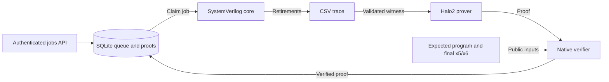

# zk-RISC-V

A self-hosted service for producing verifiable RISC-V execution receipts. Submit four RV32I `ADDI` instructions over HTTP. A durable worker simulates a synthesizable SystemVerilog core, proves the execution with Halo2, and stores the proof after verifying it in a separate process. Consumers can download the artifact and verify it offline.

**Execution profile** · RV32I `ADDI` · four proof steps · full 32-register state · native verifier

## Run the proof service

Install GNU Make, Icarus Verilog, Rust 1.88 with Cargo, Python 3.11 or newer, and `uv`. From the repository root, generate an operator token and start the service.

```sh
export ZKR_API_TOKEN="$(python3 -c 'import secrets; print(secrets.token_urlsafe(32))')"
make serve
```

Use the same token in a second terminal to submit a job and download its proof. The SDK checks the download against the size and SHA-256 in the job result.

```sh
PYTHONPATH=service python3 -m zkclient prove \
  0x00700293 0xffd28293 0xfff00313 0x00230313 \
  --idempotency-key first-proof --output build/service-proof.bin

build/cargo/release/zk-riscv-proof --verify \
  build/service-proof.bin 0x00700293 0xffd28293 0xfff00313 0x00230313 4 1
```

The service listens on `127.0.0.1:8080` and stores jobs in `build/service/jobs.sqlite3` by default. The running service publishes interactive API documentation at `/docs` and its schema at `/openapi.json`.

[HTTP API and Python SDK](docs/api.md) · [Container deployment and operations](docs/operations.md)

## Run the hardware pipeline directly

Install GNU Make, Icarus Verilog (`iverilog` and `vvp`), Yosys, and Rust with Cargo. The CI workflow targets Ubuntu 24.04 and Rust 1.88.0. The evidence collector also requires Python 3.9 or newer.

```sh
make doctor
make demo
```

The demo writes `build/trace.csv` and `build/proof.bin`. The native verifier reports a 7,872-byte proof and successful verification for this circuit.

```text
proof_bytes=7872
verification=ok
```

The verifier takes its expected statement from the command line and runs without the trace file. To rerun it independently from the repository root, use the public instruction words in program order followed by the expected values of `x5` and `x6`.

```sh
cargo run --locked --release --manifest-path proof/Cargo.toml -- \
  --verify build/proof.bin 0x00700293 0xffd28293 0xfff00313 0x00230313 4 1
```

| PC | Instruction word | Assembly | Architectural writeback |
| --- | --- | --- | --- |
| `0x00` | `0x00700293` | `addi x5, x0, 7` | `x5 = 7` |
| `0x04` | `0xffd28293` | `addi x5, x5, -3` | `x5 = 4` |
| `0x08` | `0xfff00313` | `addi x6, x0, -1` | `x6 = 0xffffffff` |
| `0x0c` | `0x00230313` | `addi x6, x6, 2` | `x6 = 1` |

## How the pieces fit



The circuit starts with all registers at zero. It constrains `ADDI` instruction decoding, sign extension, addition modulo `2^32`, writes to the selected destination, preservation of all other registers, and the zero value of `x0`. The final values of `x5` and `x6` are bound to the verifier's public inputs.

The CSV parser checks the RTL retirement records, including the PC sequence. In-circuit instruction order follows the four fixed proof steps. The verification result establishes the register transition relation for the public inputs under the proof system's assumptions. A physical-device attestation protocol and smart-contract verifier are future work. [Read the design and trust model](docs/design.md).

## Prove a custom program

Give the trace simulator a file containing four `ADDI` words, each written as eight hexadecimal digits. This program exercises wraparound and writes to `x0`. It leaves `x5 = 2` and `x6 = 0xfffffffe`.

```sh
make trace
printf '%s\n' fff00293 00328293 ffc28313 00730013 > build/program.hex
vvp build/tb_trace.vvp +program=build/program.hex > build/custom-trace.csv
cargo run --locked --release --manifest-path proof/Cargo.toml -- \
  build/custom-trace.csv build/custom-proof.bin
cargo run --locked --release --manifest-path proof/Cargo.toml -- \
  --verify build/custom-proof.bin 0xfff00293 0x00328293 0xffc28313 0x00730013 2 4294967294
```

Another execution engine can supply a compatible CSV to the same prover. [Trace ABI](docs/design.md#trace-abi).

## Verification and evidence

| Command | What it runs |
| --- | --- |
| `make test-rtl` | Self-checking RTL simulation for signed immediates, wraparound, consecutive writes, `x0`, trap handling, and reset |
| `make test-proof` | Rust tests for valid and malformed witnesses and tampered proof statements |
| `make formal` | Bounded Yosys SAT check of RTL interface behavior against a reference model, with its log in `build/formal.log` |
| `make demo` | Generate a simulation trace, compare it with the canonical fixture, and create and verify a proof in separate processes |
| `make check` | Run the regressions, bounded check, and end-to-end demo |
| `make evidence` | Run the verification workflow and record logs, trace, proof, and a structured summary under `build/evidence/` |
| `make service-test` | Exercise API contracts, job persistence, and worker behavior |
| `make service-smoke` | Submit two programs over HTTP, verify both proofs offline, reject tampered bytes, and confirm a proof survives restart |

## Roadmap

| Planned milestone | Acceptance criteria |
| --- | --- |
| Shared execution specification | Derive test cases and circuit inputs for more integer operations. Compare RTL, a reference interpreter, and the proof circuit against the same corpus. |
| Memory and constraints | Specify load and store semantics, including alignment and failure behavior. Add memory consistency constraints and measure their effect on proof size and verification time. |
| Agent-assisted review | Generate changes and test cases from the specification. Require independent review of RTL and circuit changes, deterministic regressions, and recorded solver results before merging generated changes. |
| On-chain verifier research | Select a chain and compatible proof backend. Measure verifier cost on that chain and test rejection of malformed proofs and mismatched public inputs. |

## Repository layout

| Path | Contents |
| --- | --- |
| [`rtl/`](rtl/) | Synthesizable core and self-checking simulation testbenches |
| [`proof/`](proof/) | Trace parser, Halo2 execution circuit, and prover/verifier CLI |
| [`formal/`](formal/) | Bounded reference model and Yosys SAT script |
| [`service/zkservice/`](service/zkservice/) | Authenticated HTTP API, durable queue, worker, and retention command |
| [`service/zkclient/`](service/zkclient/) | Standard-library Python SDK and operator CLI |
| [`Dockerfile`](Dockerfile) | Non-root service image built from locked Python and Rust dependencies |
| [`fixtures/`](fixtures/) | Expected simulation trace for the four-step demo |
| [`docs/design.md`](docs/design.md) | Hardware interface, trace format, proof statement, and trust model |

Licensed under the [MIT License](LICENSE).
